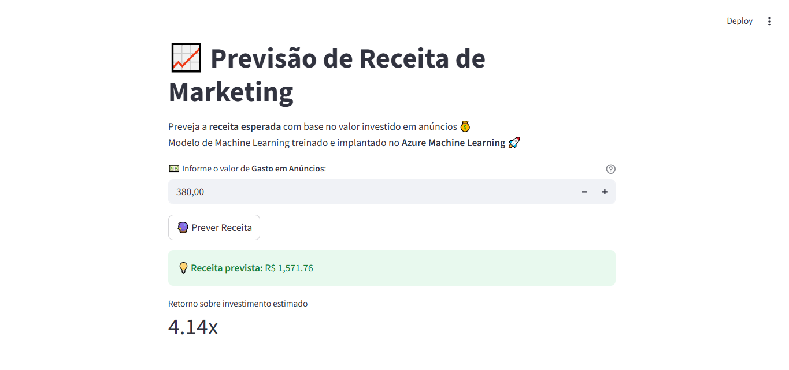
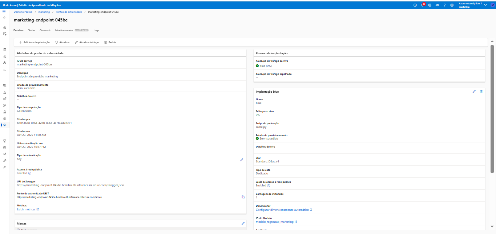
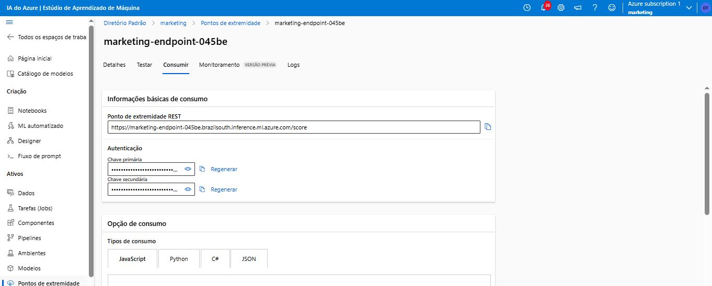
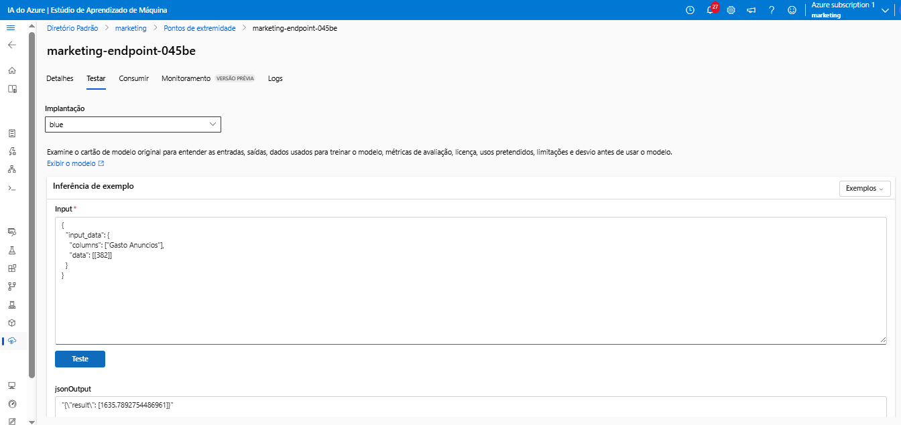
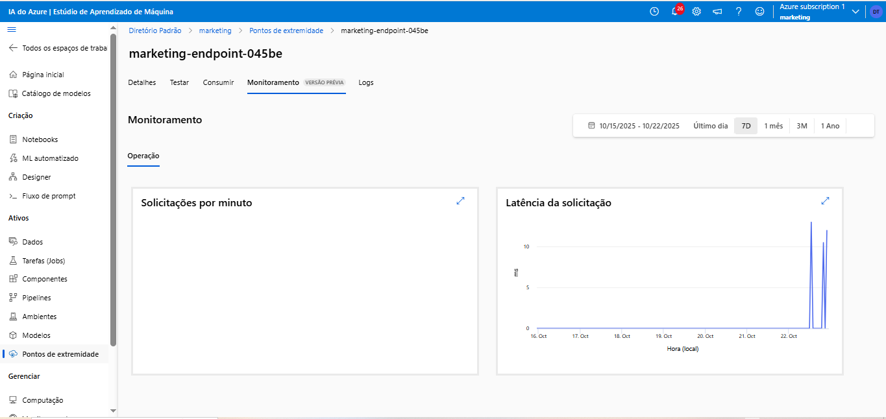

# AzureML Marketing Predictor

📊 _Previsão de Receita de Marketing com Machine Learning e Azure Machine Learning_

<p align="center">
  
</p>

---

## Visão Geral

Este projeto utiliza **Machine Learning** para prever a **receita total de campanhas de marketing** com base no valor investido em anúncios.  
Foi desenvolvido, treinado e implantado na **plataforma Azure Machine Learning**, com uma **interface interativa em Streamlit** para demonstração prática.

> 🎯 **Objetivo:** automatizar a previsão de retorno sobre investimento em marketing, auxiliando decisões estratégicas com base em dados.

---

## Gerenciamento de Permissões e Chaves de Acesso

Este projeto utiliza recursos do **Azure Machine Learning** e requer permissões e chaves válidas para acessar o workspace, registrar modelos e consumir o endpoint.

---

### Verificando Permissões na Assinatura

Para executar este projeto, o usuário precisa ter papéis ativos dentro da assinatura do Azure, como:

- `Owner` ou `Contributor` no **Resource Group**
- `AzureML Data Scientist` para operações de machine learning
- `AzureML Compute Operator` para criação e gerenciamento de clusters
- Permissão de `Microsoft.MachineLearningServices/workspaces/onlineEndpoints/*/actions` para criação de endpoints

Você pode verificar suas permissões atuais com:

```bash
az role assignment list --all --output table
```

Ou, para o workspace específico:

```bash
az role assignment list \
  --scope "/subscriptions/<subscriptionId>/resourceGroups/<resourceGroupName>/providers/Microsoft.MachineLearningServices/workspaces/<workspaceName>" \
  --output table
```
---

## 🚀 Etapas para Criação e Implantação do Modelo no Azure Machine Learning

O ciclo completo de desenvolvimento deste projeto foi realizado dentro do **Azure Machine Learning Studio**, seguindo o fluxo oficial da Microsoft descrito no tutorial abaixo:

📘 [Tutorial — Azure Machine Learning in a Day (Microsoft Docs)](https://learn.microsoft.com/pt-br/azure/machine-learning/tutorial-azure-ml-in-a-day?view=azureml-api-2)

As etapas a seguir descrevem o processo lógico de criação, treinamento e implantação do modelo de regressão linear.

---

### 1. Criação do Resource Group
Foi criado um **grupo de recursos** para concentrar todos os serviços do projeto incluindo o workspace, o storage, os endpoints e o registro de logs.  
Essa estrutura garante organização, controle de custos e facilita a exclusão completa ao final do projeto.

📖 Documentação: [Gerenciar grupos de recursos no Azure](https://learn.microsoft.com/pt-br/azure/azure-resource-manager/management/manage-resource-groups-portal)

---

### 2. Criação do Workspace do Azure Machine Learning
O **workspace** é o ambiente central de Machine Learning no Azure, onde todos os experimentos, modelos, endpoints e logs ficam armazenados.  
Durante sua criação, é gerado um **identificador único (ID do workspace)**, necessário para autenticação e integração com SDKs e scripts Python.

📖 Documentação: [Criar e gerenciar workspaces no Azure Machine Learning](https://learn.microsoft.com/pt-br/azure/machine-learning/how-to-manage-workspace?view=azureml-api-2)

---

### 3. Configuração da Instância ou Cluster de Computação
Foi configurado um **cluster de computação** com o tipo `Standard_DS11_v2`, adequado para treinar modelos de aprendizado de máquina de pequeno a médio porte.  
A infraestrutura é escalável, permitindo alocação automática de nós apenas durante a execução do treinamento, otimizando custos.

📖 Documentação: [Gerenciar instâncias e clusters de computação](https://learn.microsoft.com/pt-br/azure/machine-learning/how-to-create-attach-compute-studio?view=azureml-api-2)

---

### 4. Desenvolvimento do Script de Treinamento
O script de treinamento foi desenvolvido em Python, utilizando bibliotecas como `pandas`, `scikit-learn` e `mlflow`.  
Nele, foram implementadas as etapas de:
- Carregamento e pré-processamento dos dados;
- Treinamento do modelo de **Regressão Linear**;
- Registro automático do modelo no workspace com o nome `modelo_regressao_marketing`.

📖 Documentação: [Treinar modelos com scripts personalizados](https://learn.microsoft.com/pt-br/azure/machine-learning/how-to-train-model?view=azureml-api-2)

---

### 5. Configuração do Ambiente e Envio do Trabalho
O ambiente de execução foi configurado com dependências específicas (via arquivo `conda.yaml`).  
Em seguida, o **job de treinamento** foi enviado para o cluster de computação.  
Durante o processo, o Azure ML registrou métricas de desempenho, logs e artefatos do modelo.

📖 Documentação: [Executar trabalhos de treinamento no Azure ML](https://learn.microsoft.com/pt-br/azure/machine-learning/how-to-train-model-cli?view=azureml-api-2)
📖 Documentação: [Monitorar e revisar trabalhos no Azure ML](https://learn.microsoft.com/pt-br/azure/machine-learning/how-to-monitor-jobs?view=azureml-api-2)

---

### 6. Registro e Versionamento do Modelo
Após o término do treinamento, o modelo foi **registrado automaticamente** no workspace por meio do **MLflow**, garantindo versionamento e rastreabilidade.  
Isso permite comparar versões, reproduzir experimentos e realizar novos deployments de forma segura.

---

### 7. Criação do Endpoint Online
Foi criado um **endpoint de inferência online** (Managed Online Endpoint) para servir o modelo via API REST.  
O endpoint gera uma URL pública que pode ser utilizada por aplicações externas (como o app em Streamlit).

📖 Documentação: [Criar e gerenciar endpoints online.](https://learn.microsoft.com/pt-br/azure/machine-learning/how-to-deploy-online-endpoints?view=azureml-api-2)

---

### 8. Implantação (Deploy) do Modelo
O modelo foi implantado no endpoint por meio do arquivo de configuração `deployment_fixed.yml`.  
O ambiente utilizado foi `azureml:sklearn-env-py310:1`, com o script de inferência `score.py` e a instância `Standard_E8ds_v4`.  
O tráfego foi totalmente direcionado para o deployment ativo denominado `blue`.

📖 Documentação: [Implantar modelos em endpoints online.](https://learn.microsoft.com/pt-br/azure/machine-learning/how-to-deploy-managed-online-endpoints?view=azureml-api-2)

---

### 9. Teste de Inferência
Após o deploy, o modelo foi testado com uma requisição de amostra (`sample-request.json`), retornando previsões numéricas consistentes.  
Esses testes validam a integração completa entre o modelo treinado e o endpoint ativo.

📖 Documentação: [Testar endpoints no Azure ML](https://learn.microsoft.com/pt-br/azure/machine-learning/how-to-invoke-endpoint?view=azureml-api-2)

---

### 10. Encerramento e Limpeza de Recursos
Para evitar custos, todos os recursos criados foram revisados e podem ser removidos em bloco pelo grupo de recursos.  
Essa prática é recomendada ao finalizar experimentos e mantém a conta do Azure otimizada.

📖 Documentação: [Excluir grupos de recursos e workspaces](https://learn.microsoft.com/pt-br/azure/machine-learning/how-to-manage-workspace?view=azureml-api-2)
---

 **Resumo:**  
Este fluxo cobre todo o ciclo de vida de um projeto de Machine Learning no Azure desde a criação do ambiente até a disponibilização do modelo como serviço web, pronto para consumo em aplicações como o **app.py** desenvolvido em Streamlit.


---

## Provedores de Recursos Necessários (Resource Providers)

Para que o modelo de **regressão linear** funcione corretamente dentro do **Azure Machine Learning**, é essencial que a assinatura tenha os **provedores de recurso (Resource Providers)** corretos **registrados**.

Esses provedores são serviços internos da Azure que habilitam recursos específicos como Machine Learning, Armazenamento, Aplicações Web e Identidades sem os quais o treinamento, o registro do modelo e o deploy do endpoint podem falhar.

---

### Provedores essenciais para Machine Learning e Deploy

| Provedor | Serviço Habilitado | Descrição |
|-----------|-------------------|------------|
| **Microsoft.MachineLearningServices** | Azure Machine Learning | Necessário para criar workspaces, registrar modelos e implantar endpoints. |
| **Microsoft.Storage** | Azure Storage | Armazena datasets, artefatos e logs gerados durante o treinamento. |
| **Microsoft.ContainerRegistry** | Azure Container Registry | Usado para armazenar imagens Docker de modelos e ambientes personalizados. |
| **Microsoft.Compute** | Azure Compute | Permite criar clusters de computação e instâncias para treinar e servir o modelo. |
| **Microsoft.KeyVault** | Azure Key Vault | Gerencia chaves e segredos (como a Primary Key e o token do endpoint). |
| **Microsoft.Network** | Azure Virtual Network | Garante comunicação entre o workspace e o endpoint (caso use rede privada). |

---

### Provedores adicionais recomendados

| Provedor | Função | Motivo de ativação |
|-----------|--------|--------------------|
| **Microsoft.ADHybridHealthService** | Monitoramento de Identidade e AD | Necessário para autenticação de usuários e integração com contas Microsoft. |
| **Microsoft.Advisor** | Recomendações de custo e desempenho | Ajuda a otimizar o uso do workspace e reduzir custos de compute. |
| **Microsoft.App** | Suporte a aplicações (ex: Streamlit, Web Apps) | Permite integrar o modelo com aplicações web externas (como o app.py). |
| **Microsoft.Insights** | Application Insights | Registra logs, métricas e erros do endpoint implantado. |
| **Microsoft.Authorization** | Controle de acesso (RBAC) | Gerencia permissões e papéis atribuídos à assinatura. |
| **Microsoft.OperationalInsights** | Monitoramento centralizado | Coleta logs e métricas em tempo real. |
| **Microsoft.ManagedIdentity** | Identidade gerenciada | Permite autenticação segura entre serviços sem expor chaves. |
| **Microsoft.Cdn** | Rede de Distribuição de Conteúdo (CDN) |  Permite entregar conteúdo do modelo ou do app Streamlit com mais rapidez e estabilidade global, reduzindo latência e melhorando o desempenho da aplicação quando acessada de diferentes regiões. |

---

### 📘 Como verificar e registrar provedores via Azure CLI

Você pode listar todos os provedores registrados na sua assinatura com o comando:

```bash
az provider list --output table
```
---

## Tecnologias Utilizadas

| Categoria        | Ferramenta / Tecnologia |
| ---------------- | ----------------------- |
| Linguagem        | Python 3.10             |
| Machine Learning | Scikit-learn, MLflow    |
| Cloud            | Azure Machine Learning  |
| Interface        | Streamlit               |
| Versionamento    | Git + GitHub            |
| API              | REST (requests, JSON)   |

---

## 📸 _Detalhes do endpoint e monitoramento:
_  
  
  
  


---

## Interface de Previsão

O app foi criado com **Streamlit**, permitindo testar o modelo de forma intuitiva:

```python
st.title("📈 Previsão de Receita de Marketing")
gasto = st.number_input("💰 Informe o valor de 'Gasto em Anúncios':", min_value=0.0) 
```

Quando o usuário insere o valor, o app envia uma requisição para o endpoint da Azure ML e retorna a previsão:

## Interface visual da aplicação:


- Resultado e Impacto

- Modelo prevê o retorno estimado com base nos gastos de marketing

- Totalmente integrado à infraestrutura Azure (deploy, monitoramento e versionamento)

- Interface amigável para apresentação e testes interativos

- Aprendizados

## Sobre o Projeto

Este projeto foi desenvolvido por Dayane Teodoro como parte de sua jornada em Ciência de Dados e Inteligência Artificial, aplicando técnicas de Machine Learning para resolver problemas reais de marketing e previsão de receita.

📬 **Conecte-se comigo no LinkedIn:** [dayaneteodoro](https://www.linkedin.com/in/dayaneteodoro/)

⭐ Dica: se este projeto te inspirou, deixe uma estrela no repositório para apoiar o trabalho!

